<h1 align="center">VLC Fusion: Vision-Language Conditioned Sensor Fusion for Robust Object Detection</h1>

<p align="center">
  <b>ECML PKDD 2026</b> · Shortlisted for the Best Research Track Student Paper Award
</p>

<p align="center">
  <a href="https://doi.org/10.1007/978-3-032-37679-4_4"></a>
  &nbsp;
  
</p>

<!-- Wrap the talk badge in a link when the YouTube URL is available. -->

<table align="center" width="100%">
  <tr>
    <th colspan="2" align="center"><div align="center">Seen scenarios</div></th>
    <th colspan="2" align="center"><div align="center">Unseen scenarios</div></th>
  </tr>
  <tr>
    <th colspan="4" align="center"><div align="center">Waymo · Camera + LiDAR</div></th>
  </tr>
  <tr>
    <td align="center" width="25%"><a href="assets/demo/waymo-seen.gif">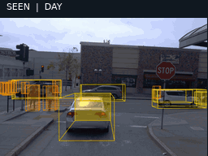</a></td>
    <td align="center" width="25%"><a href="assets/demo/waymo-seen-2.gif">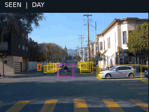</a></td>
    <td align="center" width="25%"><a href="assets/demo/waymo-unseen.gif">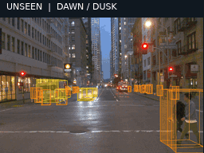</a></td>
    <td align="center" width="25%"><a href="assets/demo/waymo-unseen-2.gif">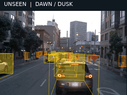</a></td>
  </tr>
  <tr>
    <td align="center" width="25%"><a href="assets/demo/waymo-seen-3.gif">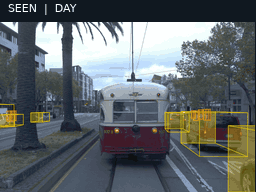</a></td>
    <td align="center" width="25%"><a href="assets/demo/waymo-seen-4.gif">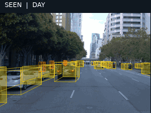</a></td>
    <td align="center" width="25%"><a href="assets/demo/waymo-unseen-3.gif">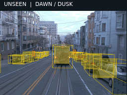</a></td>
    <td align="center" width="25%"><a href="assets/demo/waymo-unseen-4.gif">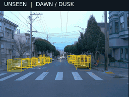</a></td>
  </tr>
  <tr>
    <th colspan="4" align="center"><div align="center">ATR · Visible + infrared</div></th>
  </tr>
  <tr>
    <td align="center" width="25%"><a href="assets/demo/atr-seen.gif">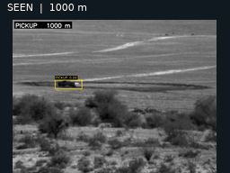</a></td>
    <td align="center" width="25%"><a href="assets/demo/atr-seen-2.gif">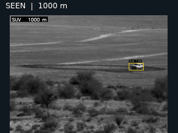</a></td>
    <td align="center" width="25%"><a href="assets/demo/atr-unseen.gif">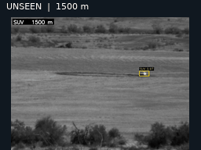</a></td>
    <td align="center" width="25%"><a href="assets/demo/atr-unseen-2.gif">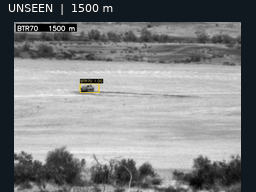</a></td>
  </tr>
  <tr>
    <td align="center" width="25%"><a href="assets/demo/atr-seen-3.gif">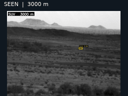</a></td>
    <td align="center" width="25%"><a href="assets/demo/atr-seen-4.gif">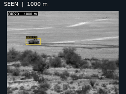</a></td>
    <td align="center" width="25%"><a href="assets/demo/atr-unseen-3.gif">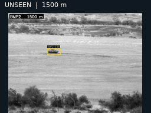</a></td>
    <td align="center" width="25%"><a href="assets/demo/atr-unseen-4.gif">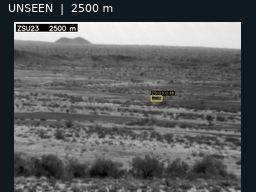</a></td>
  </tr>
</table>

## Overview

**Sensor reliability changes with the scene. Fusion should adapt with it.** A camera can provide detailed appearance information in daylight but struggle in darkness or glare. Other sensors offer complementary information, yet their usefulness also depends on the environment. Combining their features without accounting for these changes can make object detection brittle when conditions shift.

**VLC Fusion** uses a vision-language model (VLM) to describe the context in which sensor fusion happens. It turns environmental cues into a condition vector that guides how features from different modalities are combined. The resulting detector can adapt its fusion to the current scene, improving robustness in both familiar and previously unseen conditions. See the [paper](https://doi.org/10.1007/978-3-032-37679-4_4) for the method and experimental results.

## Repository guide

| Path | Contents |
| --- | --- |
| [`ATR Experiment/`](ATR%20Experiment/) | Hugging Face DETR fusion, training, evaluation, and visible/infrared preprocessing |
| [`ATR Experiment/vlc_fusion_utils.py`](ATR%20Experiment/vlc_fusion_utils.py) | VLC blocks and the ATR fusion head |
| [`Waymo Experiment/`](Waymo%20Experiment/) | MMDetection3D fusion, TFRecord conversion, evaluation, and visualization |
| [`Waymo Experiment/configs/cbam_ensemble_vlm/vlc_fusion.py`](Waymo%20Experiment/configs/cbam_ensemble_vlm/vlc_fusion.py) | Registered Waymo `VLCFusion` detector |
| [`plots/`](plots/) | Figure scripts, reference notebooks, and exported figures |
| [`assets/demo/`](assets/demo/) | Small prediction GIFs used above and their source manifest |
| [`docs/DEVELOPMENT_HISTORY.md`](docs/DEVELOPMENT_HISTORY.md) | Final method, retained baselines, and archived prototypes |

## Environment and prerequisites

Use **separate Python 3.10 environments** for ATR and Waymo. Their PyTorch, NumPy, and detection-framework versions differ. The root `requirements.txt` is an overview; installing it alone installs no packages.

| Experiment | Dependency reference | Main stack |
| --- | --- | --- |
| ATR | [`requirements.txt`](ATR%20Experiment/requirements.txt), [`environment snapshot`](ATR%20Experiment/requirements.lock.txt) | PyTorch, Transformers, Datasets, TorchMetrics, torchvision |
| Waymo | [`requirements.txt`](Waymo%20Experiment/requirements.txt), [`environment snapshot`](Waymo%20Experiment/requirements.lock.txt) | PyTorch, MMEngine/MMCV/MMDetection3D, TensorFlow, Waymo devkit |

The dependency snapshots record development environments and are **not yet portable clean-install lockfiles**. The ATR snapshot includes local build paths and unrelated packages; the Waymo pins contain dependency conflicts. ATR preprocessing also uses Pandas and scikit-learn, DETR backbones use `timm`, and figure generation uses Matplotlib. See the [repository audit](docs/REPOSITORY_AUDIT.md) for the precise setup gaps before creating a fresh environment.

With the appropriate environment activated, check it with:

```bash
python --version
python -m pip check
```

You will also need:

- The raw datasets or correctly prepared local datasets. Full datasets are not included in Git.
- Pretrained detector components and a trained fusion checkpoint for evaluation. The experiment-specific checkpoints are not distributed in this repository.
- `OPENAI_API_KEY` if generating new conditions with the API scripts. Existing condition files can be used when their sample IDs match your data.
- FFmpeg for the optional video-rendering tools.

Run commands from the working directory shown in each section. Directory names contain spaces, so quote paths when invoking scripts from the repository root.

## ATR: visible and infrared fusion

### Prepare the data

Obtain the ATR data, annotations, and metric files from the [DSIAC ATR database](https://dsiac.dtic.mil/databases/atr-algorithm-development-image-database/). The preprocessing scripts expect visible (`i1co`) and infrared (`cegr`) videos converted to `.avi`, their `.agt` annotations, and `.bbox_met` files.

```text
ATR_Dataset/
├── i1co/
│   ├── arf-video/              # Converted .avi videos
│   └── agt/
├── cegr/
│   ├── arf-video/
│   └── agt/
└── Metric/                     # .bbox_met files
```

The preprocessing helpers parse annotations, prepare frame metadata, synchronize the modalities, and extract images. Review the scenario/class mappings in [`config_utils.py`](ATR%20Experiment/ATR%20data%20preprocessing/config_utils.py) for your data.

<details>
<summary><b>Preprocessing command examples</b></summary>

Run from the repository root, replacing the three paths below:

```bash
ATR_RAW="/path/to/ATR_Dataset"
ATR_WORK="/path/to/atr_intermediate"
ATR_OUTPUT="/path/to/atr_images"

python "ATR Experiment/ATR data preprocessing/agt_to_json_convertor.py" \
  "$ATR_RAW/cegr/agt" "$ATR_WORK/cegr/agt-json"
python "ATR Experiment/ATR data preprocessing/agt_to_json_convertor.py" \
  "$ATR_RAW/i1co/agt" "$ATR_WORK/i1co/agt-json"

python "ATR Experiment/ATR data preprocessing/prepare_initial_dataframes.py" \
  --rgb_video_dir "$ATR_RAW/i1co/arf-video" \
  --ir_video_dir "$ATR_RAW/cegr/arf-video" \
  --rgb_agt_json_dir "$ATR_WORK/i1co/agt-json" \
  --ir_agt_json_dir "$ATR_WORK/cegr/agt-json" \
  --output_dir "$ATR_WORK/metadata_csvs"

python "ATR Experiment/ATR data preprocessing/combine_and_synchronize.py" \
  --ir_metadata_csv "$ATR_WORK/metadata_csvs/cegr_initial_metadata.csv" \
  --rgb_metadata_csv "$ATR_WORK/metadata_csvs/i1co_initial_metadata.csv" \
  --output_csv "$ATR_WORK/metadata_csvs/combined_synchronized_data.csv" \
  --time_tolerance_ms 100

python "ATR Experiment/ATR data preprocessing/build_image_datasets.py" \
  --combined_csv "$ATR_WORK/metadata_csvs/combined_synchronized_data.csv" \
  --base_output_dir "$ATR_OUTPUT" \
  --ir_video_dir "$ATR_RAW/cegr/arf-video" \
  --rgb_video_dir "$ATR_RAW/i1co/arf-video" \
  --ir_agt_json_dir "$ATR_WORK/cegr/agt-json" \
  --rgb_agt_json_dir "$ATR_WORK/i1co/agt-json" \
  --metric_dir "$ATR_RAW/Metric" \
  --train_ratio 0.7 --val_ratio 0.15 --random_state 42
```

The builder creates `mwir_dataset_final/` and `visible_dataset_final/`, each with `train/`, `val/`, and `test/` directories containing `images/` and `metadata.jsonl`.

**Current integration gap:** the builder writes bare filenames and `objects.category_id`, whereas the downstream pipeline needs image paths relative to the metadata file (for example, `images/frame.png`) and `objects.category`. Paired `image_id` values must also stay aligned when frames are skipped. These fixes are recorded in the [audit](docs/REPOSITORY_AUDIT.md); raw builder output is not yet ready to feed directly into training.

</details>

Training expects a Hugging Face `imagefolder` dataset for each modality. A metadata row has this structure:

```json
{"file_name":"images/frame.png","image_id":0,"height":480,"width":640,"objects":{"bbox":[[100,80,40,30]],"category":[0],"area":[1200]}}
```

Bounding boxes use `[x, y, width, height]`; classes are zero-based. Visible and infrared records must refer to the same synchronized frame pair through `image_id`. Bundled conditions belong to the original experiment splits, so a new split requires matching conditions.

### Generate conditions

The supplied ATR question list contains 19 conditions. The default VLC Fusion configuration selects seven using the **1-based** indices `16,13,1,11,15,19,18`.

```bash
cd "ATR Experiment"

# OPENAI_API_KEY must be set in your environment.
python create_conditions.py \
  "/path/to/prepared_atr/infrared_seen/train" \
  --metadata_file_name metadata.jsonl \
  --questions_file conditions/preprocess/refined_conditions.json \
  --output_file /path/to/generated_conditions/vlm_train.json
```

Repeat for validation and test data, changing the input split and output filename. Pass the generated files explicitly to the trainer.

### Train VLC Fusion

From `ATR Experiment/`, with prepared paired datasets and pretrained IR/visible DETR components:

```bash
python ensemble_trainer.py \
  --output_dir outputs/vlcfusion_atr \
  --visible_dataset_dir /path/to/prepared_atr/visible_seen \
  --ir_dataset_dir /path/to/prepared_atr/infrared_seen \
  --model_dir_1 /path/to/pretrained_ir_checkpoint \
  --model_dir_2 /path/to/pretrained_visible_checkpoint \
  --train_conditions_file conditions/seen/vlm_train.json \
  --val_conditions_file conditions/seen/vlm_val.json \
  --test_conditions_file conditions/seen/vlm_test.json \
  --ensemble_method VLCFusion \
  --num_vlc_blocks 2 \
  --condition_indices_to_sample_str "16,13,1,11,15,19,18" \
  --image_size 480 --num_classes 10 \
  --per_device_train_batch_size 8 \
  --per_device_eval_batch_size 8 \
  --gradient_accumulation_steps 2 \
  --learning_rate 5e-5 --num_train_epochs 50 \
  --eval_strategy epoch --save_strategy epoch \
  --load_best_model_at_end True --metric_for_best_model eval_map \
  --remove_unused_columns False --eval_do_concat_batches False \
  --dataloader_num_workers 4 --report_to none \
  --do_train --do_eval
```

This is an example invocation, not a complete recipe for reproducing a particular checkpoint. The trainer loads the pretrained detector components and freezes their backbones/input projections. Supported fusion choices are `VLCFusion`, `CBAM`, `FusionSSD`, `FusionSSD_SelfAttention`, and `LearnableAlign`. Use `python ensemble_trainer.py --help` for all options.

### Evaluate a checkpoint

```bash
# Run from ATR Experiment/.
python run_eval_ensemble.py \
  --checkpoint_dir /path/to/fusion_checkpoint \
  --model_dir_ir /path/to/pretrained_ir_checkpoint \
  --model_dir_vis /path/to/pretrained_visible_checkpoint \
  --visible_dataset_dir /path/to/prepared_atr/visible_seen \
  --ir_dataset_dir /path/to/prepared_atr/infrared_seen \
  --ensemble_method VLCFusion --num_vlc_blocks 2 \
  --condition_indices "16,13,1,11,15,19,18" \
  --scenario seen --batch_size 8
```

For unseen evaluation, use `--scenario unseen` and the corresponding unseen dataset directories. The script selects `conditions/{scenario}/vlm_test.json` internally; custom splits require matching those files or adapting the script. Block count, condition selection, and component models must match the checkpoint. [`run_eval_indi.py`](ATR%20Experiment/run_eval_indi.py) evaluates individual detectors, and [`test_ensemble.ipynb`](ATR%20Experiment/test_ensemble.ipynb) provides an interactive reference.

## Waymo: camera and LiDAR fusion

### Prepare the data

The conversion code targets the Waymo perception TFRecord format used by the experiments (v1.4.x). Obtain the sensor data through the [Waymo Open Dataset](https://waymo.com/open/).

Activate the Waymo environment and run from the repository root:

```bash
cd "Waymo Experiment"

# Import/converter check; no dataset required.
python mmdet_data_creation/smoke_test_single_tfrecord.py --dry-run

# Convert a small real sample and retain its output for inspection.
python mmdet_data_creation/smoke_test_single_tfrecord.py \
  --tfrecord /path/to/segment.tfrecord \
  --num-frames 2 --out /path/to/waymo_smoke_output --keep
```

Use a new output directory for the smoke test. The full conversion workflow is in [`mmdet_data_creation/lidar_dataset_creation.py`](Waymo%20Experiment/mmdet_data_creation/lidar_dataset_creation.py) and its companion notebook. It currently uses editable constants for input/output paths, time-of-day selection, and splitting. Configure those before running it; the default script selects `day` and does not automatically reproduce every paper split.

The fusion configs expect generated point clouds, camera images, `waymo_infos_*.pkl` files, and split-matched condition JSONL files. Ground-truth metric files are provided as `gt_validation.bin`, `gt_testing.bin`, and `gt_dawn_dusk_testing.bin`; use them only with their matching experiment splits. [`gt_bin_creator.py`](Waymo%20Experiment/gt_bin_creator.py) is available for regeneration, but its variation and splitting logic also need to match the conversion workflow.

See [Waymo evaluator setup](Waymo%20Experiment/WAYMO_EVAL_SETUP.md) for the bundled official metric executable and platform requirements. With the recorded protobuf 4.x environment, the converter smoke test enables the Python protobuf implementation; the full conversion script may also require `PROTOCOL_BUFFERS_PYTHON_IMPLEMENTATION=python`.

### Conditions and configuration

Bundled condition files include the main GPT-4o responses and Moondream2/SmolVLM alternatives. The current Waymo detector selects 10 entries from the 40-condition vector. [`get_conditions.py`](Waymo%20Experiment/get_conditions.py) generates new responses:

```bash
# Run from Waymo Experiment/; OPENAI_API_KEY must be set.
python get_conditions.py \
  /path/to/front_camera_image_root \
  /path/to/waymo_infos_train.pkl \
  --questions_file conditions/preprocess/refined_conditions.json \
  --output_jsonl_file /path/to/generated_waymo_conditions.jsonl
```

The image root must resolve each `CAM_FRONT.img_path` in the infos file. **Current integration gap:** this generator writes `original_img_path`, while the fusion loader expects `image_path`. Adapt that field before using newly generated files. The bundled experiment JSONL files already use the loader's schema.

Before training or evaluating, edit a copy of a supplied config to set:

- `model.lidar_model_path`, `model.lidar_model_cfg_path`, and `model.rgb_model_path`.
- Dataset roots, annotation files, data prefixes, and image-loader paths.
- Train/validation/test condition JSONL paths and matching evaluator ground-truth files.

Changing a top-level `data_root` through `--cfg-options` does not retroactively update paths already constructed from it in the config; edit the source config or override every affected nested field.

| Config | Current test setup |
| --- | --- |
| [`vlc_fusion_10_conditions.py`](Waymo%20Experiment/configs/vlc_fusion_10_conditions.py) | Dawn/dusk; test conditions currently select SmolVLM |
| [`vlc_fusion_10_conditions_no_cosine.py`](Waymo%20Experiment/configs/vlc_fusion_10_conditions_no_cosine.py) | Night/day; main condition files |

### Training and evaluation

[`trainer.py`](Waymo%20Experiment/trainer.py) is the experiment training entry point. It currently reads its config, work directory, resume behavior, and GPU selection from constants in the script. Update those settings before running:

```bash
# Run only after adapting trainer.py and the selected config.
python trainer.py
```

It does **not** parse `trainer.py CONFIG --work-dir ...`; the earlier README example was incorrect. The generic `tools/train.py` has a CLI, but it does not reproduce all registrations and patches in the experiment trainer.

For evaluation, use the CLI in `eval.py`:

```bash
# Run from Waymo Experiment/ after adapting the config's paths.
CUDA_VISIBLE_DEVICES=0 python eval.py \
  --config configs/vlc_fusion_10_conditions.py \
  --checkpoint /path/to/fusion_checkpoint.pth \
  --split both \
  --work-dir eval_output/vlcfusion \
  --cfg-options model.test_jsonl_file=conditions/dawn_dusk_testing.jsonl
```

Here the explicit condition override selects the main GPT-4o dawn/dusk conditions. `--split val`, `test`, or `both` chooses the loaders defined by the config. Evaluation reports official Waymo 3D mAP/mAPH through `CustomWaymoMetric`.

## Citation

If you use VLC Fusion in your research, please cite our paper:

```bibtex
@inproceedings{taparia2027vlc,
  title     = {{VLC Fusion}: Vision-Language Conditioned Sensor Fusion for Robust Object Detection},
  author    = {Taparia, Aditya and Ngu, Noel and Leiva, Mario and
               Kricheli, Joshua Shay and Corcoran, John and Bastian, Nathaniel D. and
               Simari, Gerardo and Shakarian, Paulo and Senanayake, Ransalu},
  booktitle = {Machine Learning and Knowledge Discovery in Databases. Research Track and Applied Data Science Track},
  series    = {Lecture Notes in Computer Science},
  volume    = {16948},
  pages     = {51--68},
  publisher = {Springer Nature Switzerland},
  address   = {Cham},
  year      = {2027},
  doi       = {10.1007/978-3-032-37679-4_4},
  url       = {https://doi.org/10.1007/978-3-032-37679-4_4}
}
```
